# OrcPub UX Guide

The baseline for anything a player sees or touches in the builder: where things go, what they say,
and how designs get reviewed. Read it before designing a screen, a notice or a control. Every
picture is the real builder at phone width. Colours and themes have their own system
([frontend-redesign-parallel-work.md](frontend-redesign-parallel-work.md)); content names follow
[content-naming-style.md](content-naming-style.md). The owner reviews it as a page:
https://claude.ai/artifact/GMj4ybrucJCesuKC3AU7xp

## A floor, not a ceiling

The app's screens are meant to keep getting better. This guide records the best agreed so far, so
every change starts there and nothing agreed gets lost.

- **A better pattern replaces the old one here,** in the same change, and the log says what it
  replaced.
- **Existing screens are not precedent.** "The app already does it this way" is a starting point to
  improve on.
- **Propose improvements** with a mockup, rather than quietly matching an older screen.

## Show it beside the control that changes it

A planned pick sits by the level picker that brings it back. A heading for a choice the player
cannot make yet makes them hunt for it.

| Do | Avoid |
|---|---|
| 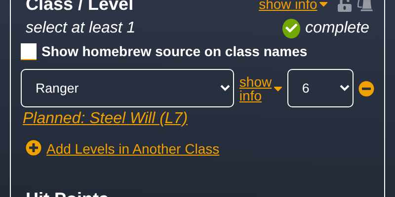 | 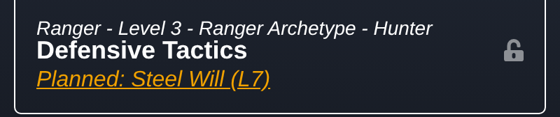 |
| Under the class, beside the level picker. | A heading for a section the player cannot use yet. |

## Size things by the layout, not by their content

A box takes its width from the page: it shares the edges of the column it sits in, and it keeps its
size when its text changes. Shrink-wrapping a box to its text gives every state a different,
arbitrary width.

| Do | Avoid |
|---|---|
| 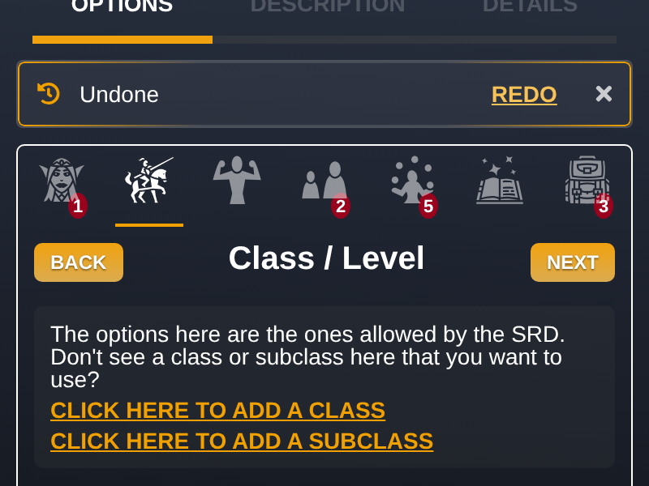 | 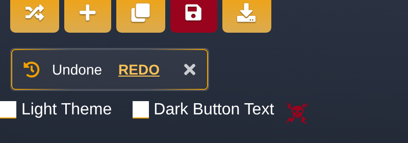 |
| The column's width; the same size for every state. | Sized to its text; it changes width when the text does. |

## Nothing hides, and each fact has one home

Every stored choice can be seen, or reached in one tap, from where a player would look. Say it once,
where it belongs; do not repeat it on other sections.

| Do | Avoid |
|---|---|
| 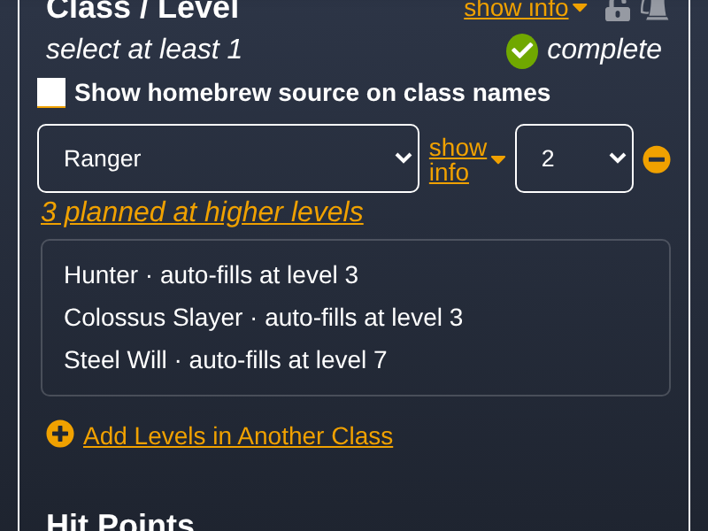 | 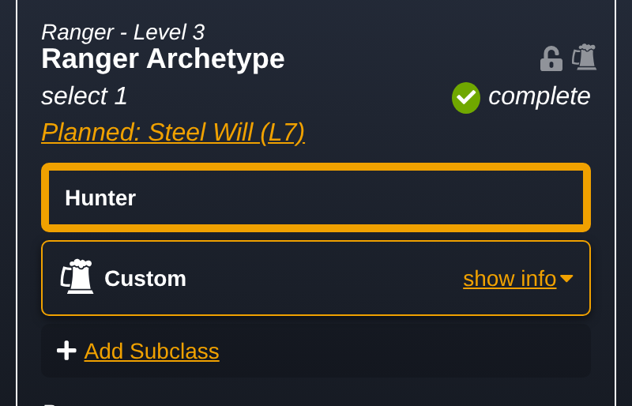 |
| One line per class; tapping lists every planned pick. | The same fact repeated on another section. |

## The fallback is the exception

Wrapping and overflow handle rare cases. Design so the usual case fits on one line, and check with
long real names ("Great Weapon Fighting").

| Do | Avoid |
|---|---|
| 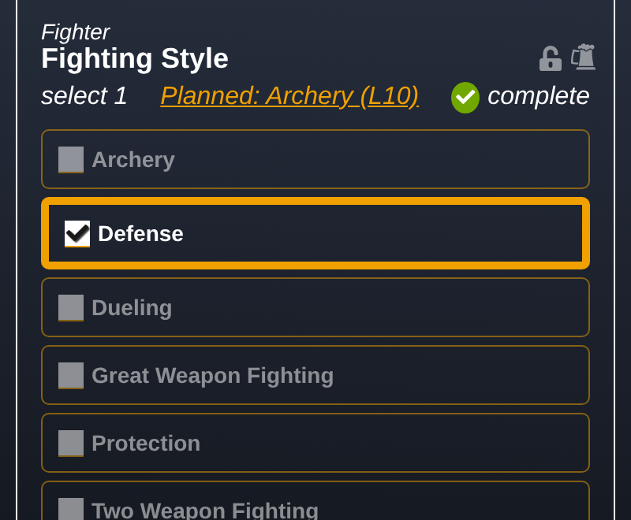 | 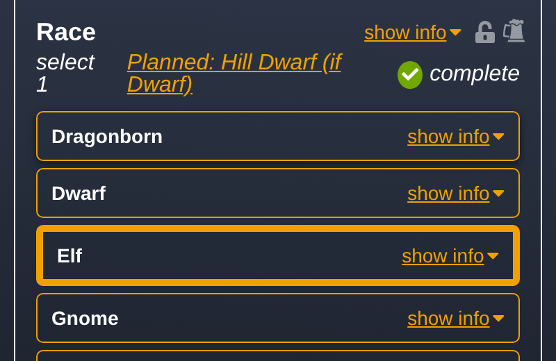 |
| The marker fits in the row. | A long label squeezing the row: rethink the placement. |

## Quiet, unless the player must act

Status is calm. A notice that carries an action stays until it is dealt with; a banner that
disappears is for confirmations.

| Do | Avoid |
|---|---|
| 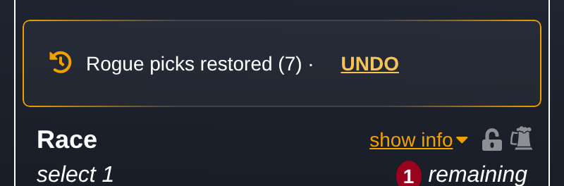 | 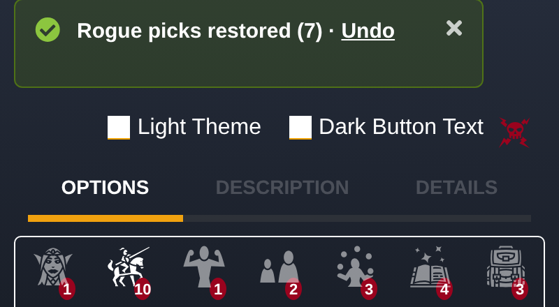 |
| A notice with Undo, in the builder's notice box. | An action in a banner that goes away by itself. |

## Mistakes cost nothing

An automatic change says what it did and can be undone; Undo then offers Redo in the same place
("Undone · Redo"). A player's experiments never lose their work.

## Words

A few glanceable words: the thing's name, then when or why. The player's words, in the present
tense. Internal terms (*hold*, *set aside*, *settle*, *ghost*, *disqualified*) stay in the code.

| Say | Not |
|---|---|
| Steel Will auto-fills at level 7. | Steel Will will be restored when its gate reopens. |
| Planned: Archery (L10) | 1 set aside · Archery held |
| 3 choices don't apply right now · Details | 3 ghost selections were found and cleaned |
| Rogue picks restored (7) · Undo | Restored 7 entries from the planned hold |
| Undone · Redo | Undo complete |

## Where things go

The app's patterns and what each is for. When a better one is agreed, it replaces the old one here.

| Pattern | For | Example |
|---|---|---|
| Top banner | a confirmation or error that needs no action, gone by itself | "Saved" |
| Notice box above the options column, at its width: an icon and a balanced amber gradient ring, no coloured fill, text left and action with its close mark right | a notice with an action, until dismissed; never reads as a warning | 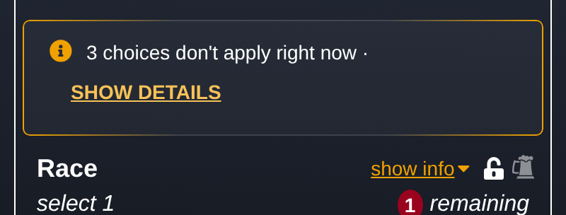 |
| In the section row | the state of that section | "Planned: Archery (L10)" |
| Under a class row, beside the level picker | what the class's level or order is holding back | "3 planned at higher levels" |
| Details under a notice | a list behind a notice's "Details": a square band across the box with the box showing below it, like an opened shell; names in one column, when each applies in the next; an arrow on "Details" that flips when open | 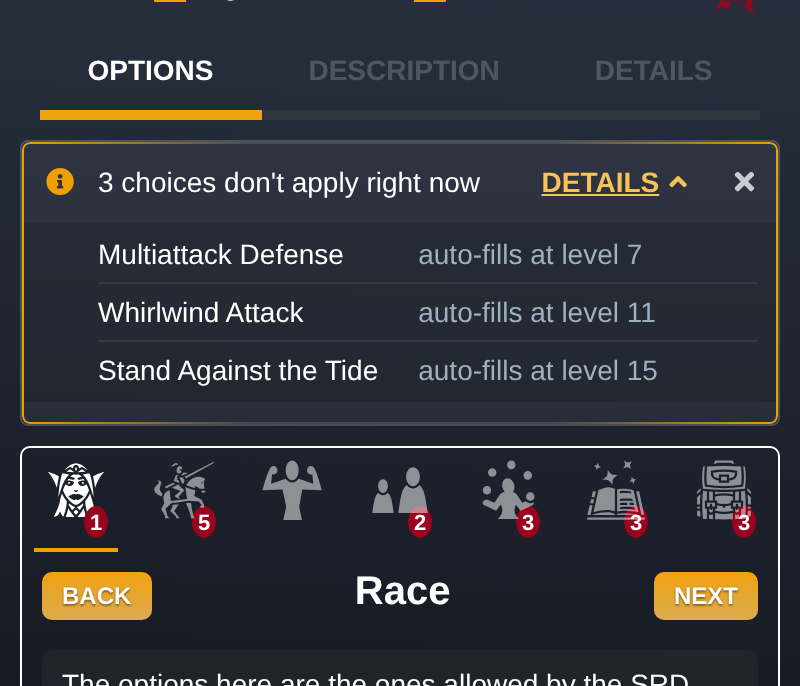 |
| Link button inside text | an action within a sentence | "Details" |

## Phone first, and how designs are reviewed

- Check every placement at 400px wide, with long real names.
- One line unless it truly cannot fit. Tap targets at least 44px tall.
- Mockups are real builder states reached by clicking, at phone width, with only the new parts drawn
  in. No abstract canvases: the owner reviews on a phone.
- One review page, one card per decision, two or three options each. The owner's ruling goes in the
  log below, with the date and the reason, in the same change.

## Decisions log

Newest last. Date, ruling, and what it replaced.

- 2026-10-03: "Planned" is the player's word for a pick that stopped applying and will return.
  Replaced "set aside" in player copy.
- 2026-10-03: no "Keep instead" action; switching a pick is just a click.
- 2026-10-08: notice wording for testing: "Steel Will auto-fills at level 7."; "Rogue picks restored
  (7) · Undo", then "Undone · Redo"; "3 choices don't apply right now · Show details".
- 2026-10-09: content names in Title Case.
- 2026-10-11: the Planned marker sits in the section row; several become a count ("2 planned"); it
  wraps to its own line only when the row cannot fit it.
- 2026-10-11: notices with an action go in the builder's notice box, with a subtle flair so they are
  noticed.
- 2026-10-13: picks waiting on a level show once, under the class, beside the level picker.
  Replaced headings for sections that are not open yet.
- 2026-10-13: picks waiting on the starting class use the same line under that class, as a fallback
  until a better design is found.
- 2026-10-13: the notice box gets an icon and a balanced amber gradient ring, no coloured fill.
  Replaced the faint outline.
- 2026-10-13: boxes are sized by the layout, not their content; the restore notice spans the
  options column. Replaced a notice shrink-wrapped to its text.
- 2026-10-14: a toggle keeps one short label in both states ("Details"), so the notice stays on
  one line at phone width. Replaced "Show details" / "Hide details".
- 2026-10-14: a notice's details sit in a square, edge-to-edge band with the box showing below it,
  as two columns (name, then when). Replaced a plain list run on under the sentence.

**Open:** where a subrace waiting on its race shows (the section row crowds the header; the race
card squeezes the name).
