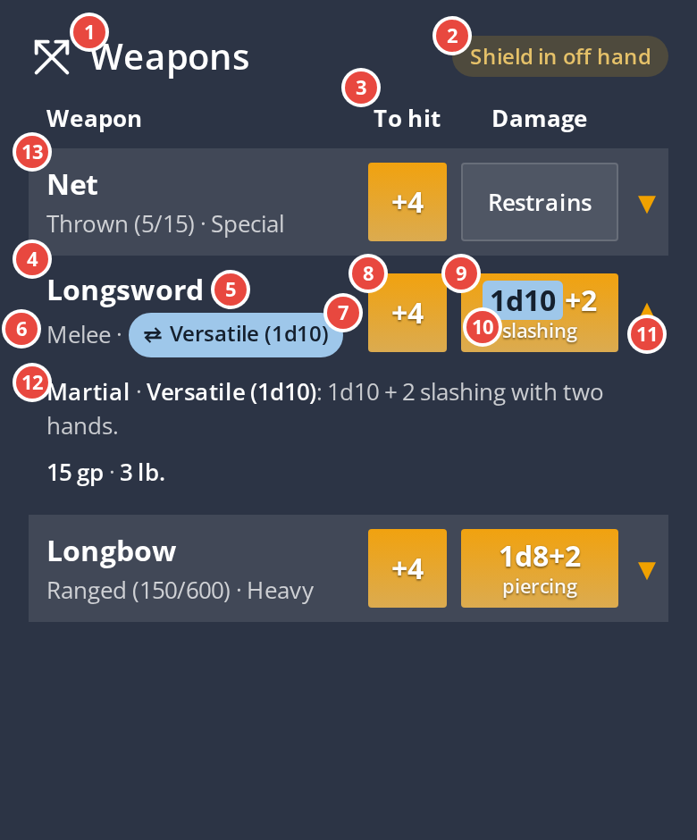

# Weapons table: the spec

The character sheet's Weapons section, redesigned. Every mockup and the build must meet every
"Agreed" line; check them one by one before showing anything. Decisions are the owner's,
2026-10-15. Background: [equipment-parity.md](equipment-parity.md) (the Net), [ux-guide.md](ux-guide.md).

## The parts and their names

Use these names, in this doc and in every session, so "row", "chip" and "details" mean one thing.

| # | Name | What it is |
|---|---|---|
| 1 | **Section heading** | "Weapons", with its icon |
| 2 | **Reason pill** | the gold "Shield in off hand", beside the heading |
| 3 | **Column headings** | Weapon · To hit · Damage |
| 4 | **Weapon row** | one weapon's line in the table |
| 5 | **Weapon name** | bold, first line of the row |
| 6 | **Grey line** | the muted properties line under the name |
| 7 | **Versatile chip** | the toggle in the grey line |
| 8 | **To-hit button** | "+4", rolls the attack |
| 9 | **Damage button** | "1d8+2 / slashing", rolls the damage |
| 10 | **Dice tab** | the blue patch on the changed dice while Versatile is on |
| 11 | **Expand arrow** | opens and closes the row |
| 12 | **Opened row** | what shows under a row when its arrow is open (rules text, cost, weight) |
| 13 | **Row shading** | the striped background on every second weapon row |

## Agreed

| # | Rule |
|---|---|
| 1 | **Columns:** Weapon · To hit · Damage · (expand arrow). Headings stay. Headings and rows share one grid sized in px; each heading's centre is within 2px of its buttons' centre, measured. |
| 2 | **No Details or Proficient? column.** Proficiency shows only when it is missing: "Not proficient" in the weapon's grey line. |
| 3 | **Weapon cell:** the name in bold, then one muted line, SRD style: "Melee · Versatile (1d10)", "Ranged (150/600) · Heavy", "Thrown (5/15) · Special". It fits on one line at 390px. |
| 4 | **To hit:** "+4", not "1d20+4", in the app's `.roll-button`. |
| 5 | **Damage:** the app's `.roll-button` with the dice ("1d8+2") and the damage type under it ("slashing"). |
| 6 | **A weapon with no damage (the Net):** no damage button; a neutral `.chip` with its short summary, "Restrains". The full SRD text is in the opened row. The PDF reads "None (restrains)". |
| 7 | **Versatile is visible in the row** and does not make the row taller than its neighbours. No stacked "v 1d10+2" button. How: see Open. |
| 8 | **Only the app's own styles:** `.roll-button` as it is (amber gradient, white text, its text shadow), `table.striped` rows, `.p-10` cells, `.chip`, the amber active tint `rgba(240,161,0,0.28)`. No new colours, buttons or spacing. White on amber failing contrast (2.11:1) is a separate, app-wide ticket. |
| 9 | **Fits a 390px phone:** the table is no wider than its container; every cell is centred vertically in its row. |
| 10 | **Small spaces get the short summary, the opened row gets the full text** (UX guide, 2026-10-15). |
| 11 | **Review on a phone:** true-size phone screenshots of the real app, today beside the proposal. No design canvases for review. |
| 12 | **Versatile is a chip in the grey line** (owner, 2026-10-15): `fa-exchange-alt` + "Versatile (1d10)", screen reader "Use two hands". Off: outlined in the state blue. On: filled state blue. While on, the changed dice ("1d10") sit on a tab of the same blue inside the amber damage button. |
| 13 | **Colour roles:** amber means roll; the state blue marks a switched-on state. State blue is a per-theme token from the app's "Shared" blue: dark `#9ec7ea` with ink `#15202e`, light `#2b567a` with white. |
| 14 | **Pulse:** while the chip is offered (off hand free, Versatile off) it pulses every 10s for one minute, then stops. Touching it, or rolling that weapon, stops it for good; it restarts only when the off hand becomes free again or the page is reopened. No pulses under reduced motion (static glow only). |
| 15 | **Shield rule** (owner, 2026-10-15: "excellent UX"): grip comes from what is equipped, never a separate setting. With a shield (or a second weapon) in the off hand, the Versatile chip is greyed (the app's `.disabled` look, opacity 0.5), two-handed damage is not offered, and the opened row says why: "Two hands: not while your off hand holds a Shield." |
| 16 | **Two-handed weapons under a shield are a reminder, not a block** (owner, 2026-10-15): their roll buttons still work. Their roll buttons become amber outlines, matching the chip's off style (owner, 2026-10-15; dimming was tried and read muddy, as "unavailable"). The opened row says "Needs both hands: your off hand holds a Shield."; a roll's result adds "(needs both hands)". |
| 17 | **One reason pill, not one per row** (owner, 2026-10-15): while a shield is held, "Shield in off hand" sits beside the Weapons heading in the app's gold "heads-up" pill (`.share-pill-expired`: `#e5c169` on a gold tint; light `#8a5a00`). Not red: red is the app's error colour and a shield is a normal choice. One pill because the shield is one fact affecting several rows (UX guide: each fact has one home). |

## Open

- **Working prototype:** https://claude.ai/artifact/Kf86pSNkyFi2QJEuRMQsTd. Since 2026-10-16 it merges the "9a" skin study (another agent's handoff, shared by the owner): roll tiles with a label strip (`hit`, damage type with a dot), the opened row as an inset panel, a dashed "Restrains / no roll" tile, damage-type dots with a coloured-strip player option. Kept from this spec: the app's amber gradient with white text (the study's dark-on-orange and flat new orange conflict with rules 8 and the owner's rejections), the Versatile chip and blue dice tab (the study's "1H/2H" switch drops the owner's "Versatile" label), the striped table (the study's card rows would not match Armor), the shield states. Fixed from the study: no-roll border raised to 3.6:1 or better (study 2.2:1); the study's blue die text on orange failed at 4.07:1. Proposal, not yet decided.
- **Owner feedback on the merged prototype (2026-10-16), not yet applied:** damage-type strips should follow the theme by default (neutral dark strips with a dot on dark; coloured strips on light), player setting overrides. The Versatile chip is a downgrade from the 9a study's "1H | 2H" switch: switch to it (screen reader: "Versatile: one hand or two hands"), keeping the blue dice tab and the shield greying. This reverses rule 12's chip.
- **Desktop layout**, **200% text** (must wrap without clipping), **the opened row**, and **Armor in the same style**: not yet designed.

## Wanted, not yet scoped

- **Player customisation of these colours** (owner, 2026-10-15): the chip's state colour and similar accents as a per-player preference, saved to the account (or the browser for signed-out players). Build the colours as theme tokens from the start, so a preference is one more layer over the theme rather than a rewrite. The theme registry on `port/redesign-on-refactor` already treats themes as data with tokens and a per-token policy ([frontend-redesign-parallel-work.md](frontend-redesign-parallel-work.md)); a preference would override tokens the policy marks choosable. Saved per account needs a stored field, so it carries the usual rules for user-facing keys.

- **Button text colour as a preference:** white text default, dark text as a player preference. The app already has an opt-in `.app.dark-button-text` (dark theme only) in `styles/core.clj`, so this is surfacing it. Settings menus show live example elements beside each choice (owner, 2026-10-16).

## Rejected: do not bring back

Dark text on amber (also rejected 2026-09-16 for the share button) · invented or darker amber
buttons · flat buttons · cards (option C) · stat-block lines (option B) · dotted underlines on many
words · a "Main hand / Off hand" strip · a separate two-handed line under the damage · dropping the
headings · labels inside the To hit button in place of headings · testing a change on today's table
instead of on this layout.

## How mockups are made

`scripts/design/weapons-table-shots.js` (agents/develop) is the capture script: one server boot,
every Agreed rule measured (table fits, headings within 2px, rows centred, grey lines on one line,
buttons in a row one height, nothing touching a cell edge). Spacing that passed (2026-10-15): cells
8px top and bottom, the weapon column 10px from the edge, button columns 4px a side, buttons and
the Restrains box 44px tall; columns To hit 56px, Damage 100px (120px for the split), arrow 24px.
The grey line is greyed by colour (`rgba(255,255,255,0.75)`), never by `opacity`: opacity fades
anything inside it, and it washed out the Versatile chip. Font Awesome is 5.13: `fa-exchange-alt`.

One way only: the real app (`lein e2e-server` or `scripts/e2e/run.sh`), the weapons table rewritten
in the page with the app's own classes, captured at 390px (and 1280px for desktop). Before any image
goes to the owner: measure rules 1 and 9, check every row of the Agreed table against the image,
and look at the image.
